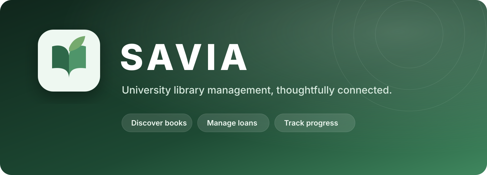

# SAVIA

**A mobile-first university library application for discovering books, managing circulation, and tracking reading progress.**

**React 19 · TypeScript 6 · Firebase 12 · Vite 8**

### [Explore the live application →](https://savialy.netlify.app/)

### [View the source code on GitHub →](https://github.com/Fernanda-Escobar-Fullstack/savia)

SAVIA brings university library tasks into one responsive experience. It combines real Open Library catalog data with Firebase-backed accounts, loans, reservations, wishlists, reading states, and notifications.

## Watch the product demo

[](docs/media/savia-demo.mp4)

### [▶ Watch the full 1080p demo video](docs/media/savia-demo.mp4)

The 73-second walkthrough focuses on the core circulation journey: discover a title, inspect its availability, borrow it, track reading progress, return it, retain its history, and reserve an unavailable book.

## What SAVIA supports

- Search the Open Library catalog by title, author, or keyword, with debounced requests, category filters, sorting, and pagination.
- Open detailed book records with descriptions, subjects, covers, and current availability.
- Register, sign in, restore sessions, and protect application routes with Firebase Authentication.
- Borrow available books for a 21-day period or reserve unavailable titles.
- Manage active loans, reservations, return history, and a personal wishlist.
- Track each borrowed title as **To Read**, **Reading**, or **Completed**; completion is required before return.
- Notify reserving users when a returned book becomes available.
- Switch between light and dark themes, persisted in local storage.

## Technology

| Layer | Tools |
| --- | --- |
| Interface | React 19, TypeScript 6, CSS Modules |
| Navigation and state | React Router 7, Redux Toolkit, React Redux |
| Catalog integration | Axios, Open Library API |
| Identity and persistence | Firebase Authentication, Cloud Firestore |
| Tooling | Vite 8, ESLint, Netlify |
| Testing | Jest, React Testing Library, jsdom |

## Architecture

```text
Browser
  ├─ React pages and reusable components
  ├─ React Router (lazy-loaded, protected routes)
  ├─ Redux Toolkit
  │    ├─ authentication session and errors
  │    └─ catalog query, filters, sorting, pagination
  └─ typed service layer
       ├─ Open Library API → catalog and book metadata
       └─ Firebase
            ├─ Authentication → identity and session restoration
            └─ Firestore → profiles, loans, reservations,
                           reading states, wishlists, notifications
```

The UI keeps remote operations behind focused service modules instead of coupling pages directly to SDK calls. Firestore transactions coordinate loan, availability, reading-status, reservation, and notification writes. Real-time listeners keep book availability and user-facing state current. Page-level code splitting limits the initial route payload, while `AbortController` prevents stale catalog responses from winning a newer search.

## Run locally

### Prerequisites

- Node.js 22
- npm
- A Firebase project with Email/Password Authentication and Cloud Firestore enabled

```bash
git clone https://github.com/Fernanda-Escobar-Fullstack/savia.git
cd savia
npm ci
cp .env.example .env
npm run dev
```

Populate `.env` with the web configuration from your Firebase project:

```env
VITE_FIREBASE_API_KEY=
VITE_FIREBASE_AUTH_DOMAIN=
VITE_FIREBASE_PROJECT_ID=
VITE_FIREBASE_STORAGE_BUCKET=
VITE_FIREBASE_MESSAGING_SENDER_ID=
VITE_FIREBASE_APP_ID=
```

Never commit `.env`; the repository already excludes local environment files.

## Commands

| Command | Purpose |
| --- | --- |
| `npm run dev` | Start the Vite development server |
| `npm run build` | Type-check and create the production build |
| `npm run preview` | Preview the production bundle locally |
| `npm run lint` | Run ESLint across the repository |
| `npm run test:unit` | Run unit tests serially |
| `npm run test:integration` | Run integration tests serially |
| `npm run test:run` | Run the complete Jest suite serially |

## Testing strategy

Unit tests target reusable UI, Redux reducers, and debounce behavior. Integration tests exercise authentication outcomes, route protection, catalog rendering, search, and filter state while mocking external services so the suite does not mutate Firebase data.

## Author

Fernanda Escobar
